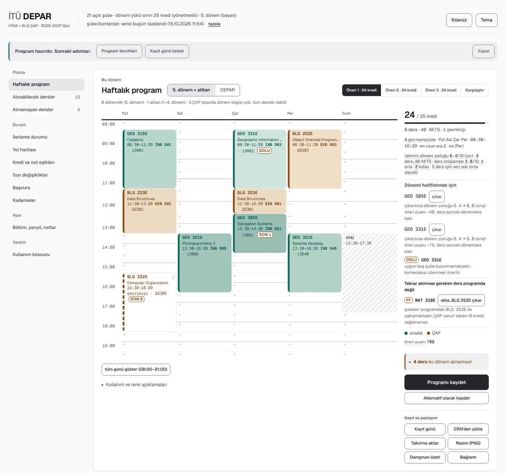
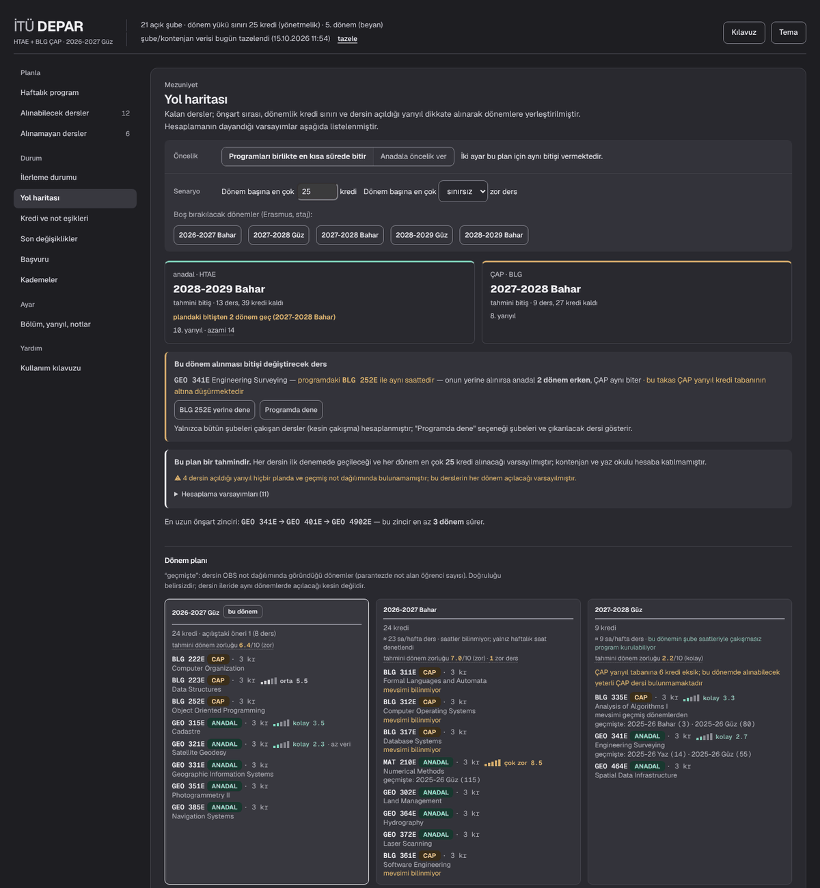
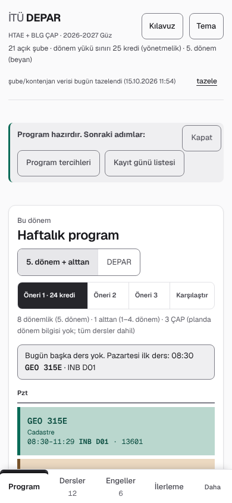

# İTÜ DEPAR — Course Planning Tool

[Türkçe](README.tr.md) · **English**

İTÜ DEPAR (**DE**rs **P**lanlama **AR**acı, "course planning tool") helps
undergraduate students at Istanbul Technical University (İTÜ) build **this
term's timetable** and a **plan all the way to graduation**. Alongside the
major, it supports **double major (ÇAP)** and **minor (yandal)** programs.

**Web version:** <https://alptugan77.github.io/ITU_Ders_Planlama_Araci/>
(nothing to install, works on phones too). The interface is in Turkish.



<sub>Screenshots are taken from a <b>fictional</b> sample student built with
`make vitrin`; they belong to no real person.</sub>

> [!IMPORTANT]
> This tool is **for information only** and is not an official İTÜ tool.
> Check registration decisions with your academic advisor and with OBS (the
> university's student information system). The tool never registers
> courses for you and never asks for your OBS password. Registration itself
> is done by the student in Kepler.

---

## Contents

1. [Why DEPAR?](#why-depar)
2. [Quick start](#quick-start)
3. [Features](#features)
4. [Core principle: uncertainty is shown, never hidden](#core-principle-uncertainty-is-shown-never-hidden)
5. [Ways to use it](#ways-to-use-it)
6. [Installation (local version)](#installation-local-version)
7. [Commands](#commands)
8. [Configuration](#configuration)
9. [Data sources and updates](#data-sources-and-updates)
10. [Privacy and security](#privacy-and-security)
11. [Architecture](#architecture)
12. [Tests and quality checks](#tests-and-quality-checks)
13. [Publishing the web version](#publishing-the-web-version)
14. [Contributing](#contributing)
15. [Disclaimer and license](#disclaimer-and-license)

---

## Why DEPAR?

Following the curricula of more than one program at once is hard to do by
hand. A student has to answer all of these together:

* Which course counts toward which program, and which prerequisites are met?
* Can a clash-free timetable be built from the sections open this term?
* Does the plan exceed the term credit limit or fall below the double-major
  per-term credit floor?
* In which term will I graduate, and what happens if I fail a course?

İTÜ DEPAR computes these from the curricula, course catalog, section data
and regulations published on OBS. Every assumption behind a result is stated
next to it. Personal data (transcript, grades, preferences) stays in the
user's browser or on their own computer.

## Quick start

On the web version, three steps are enough:

1. **Program and term.** In *Bölüm, yarıyıl, notlar* (program, term, grades),
   pick your major and current term; add your double major or minor if you
   have one.
2. **Courses you have taken.** The **Plandan işaretle** (mark from plan)
   window lists your curriculum term by term; tick the courses you have
   passed. To use your real grades, paste your OBS transcript into
   **Transkript yapıştır** in the same window. A course without a grade is
   counted as DD.
3. **Suggested timetable.** The tool suggests a few weekly timetables
   (Öneri 1, 2, 3). Save the one you like, then enter the CRNs from the
   **Kayıt günü** (registration day) list into Kepler.

The in-app **Kılavuz** (guide) button explains every feature, with buttons
that take you to the relevant view.

## Features

### This term's timetable

* **Clash-free timetable suggestions.** Open sections, prerequisites,
  quotas, the term credit limit and the critical path are weighed together
  to build weekly timetables. Suggestions can be compared side by side.
* **Timetable preferences.** Earliest class time, free days, campus changes,
  online sections and instructor preferences affect the ranking of
  suggestions without ruling any out. Their effect can be previewed before
  saving.
* **Locking and busy hours.** A course can be locked to a specific section
  or time range; no class is placed in hours kept free for work, an
  internship and so on.
* **Section details on the timetable.** Building and room, full sections or
  sections with only a few seats left, online classes, and back-to-back
  classes on different campuses are marked. A full section can be swapped
  for an open one in one tap.
* **Term difficulty and "Dönemi hafiflet" (lighten the term).** An estimated
  term difficulty out of 10 is computed from past grade distributions, the
  number of courses, credits and ECTS. When a term is heavy, the tool
  suggests which course to drop to lighten it most without delaying
  graduation.
* **Equivalent courses without a petition.** Courses that are officially
  equivalent to a course in your plan, and whose section is open to your own
  program (major, double major or minor code), are offered as candidates and
  count in place of the planned course. Renamed courses (for example old BLG
  codes and their new BBF counterparts) are recognised through their aliases.
* **Make-up exam sections.** Sections whose teaching method is "Ek Sınav"
  (extra exam) are shown separately, as regulations describe them: exam
  rights without class hours.
* **Saving and sharing.** Timetables can be saved as Plan A, B, C. The
  **Kayıt günü** list gathers the CRNs to enter into Kepler and opens
  offline too. A timetable can be exported as a calendar file (`.ics`), an
  image (PNG, with theme and phone layout options), an advisor summary or a
  shareable link. A registration done in Kepler can be brought back with
  **CRN'den yükle** (load from CRNs).
* **Next class on the phone.** On phones, the day's next class and its room
  appear above the timetable.

### Progress and graduation plan



* **Progress panel.** The major and the second program are tracked
  separately, with a term strip and the remaining slots. The state reached
  once this term's courses are completed is shown too.
* **Graduation roadmap.** Remaining courses are placed into terms taking
  into account prerequisite order, the term credit limit, the term in which
  each course is offered, weekly hour availability and the double-major
  per-term credit floor. Each program's estimated graduation term is
  compared with the planned one and with the maximum study period. The
  longest prerequisite chain is shown as well.
* **Roadmap priority.** Students with a second program get two settings:
  *"Programları birlikte en kısa sürede bitir"* (finish both programs as
  soon as possible) and *"Anadala öncelik ver"* (prioritise the major). The
  roadmap is built with several placement orders and the best one for the
  chosen goal is shown; the other setting's result is given for comparison.
  The setting also affects this term's suggestions.
* **Scenarios and planning load.** The maximum credits per term (any value),
  terms to leave empty (Erasmus, internship) and the number of hard courses
  per term can be changed to see how graduation moves, without saving.
  A realistic credit value can be saved as the **planning load**; the
  roadmap, the failure risk and double-major options all use the same load.
  For a credit value above the current limit, the GPA the regulation
  requires is stated.
* **Decision support.** "Courses that would bring graduation forward if
  taken this term" (including which course in the timetable they would
  replace), a "taken in summer school" estimate and "how much graduation is
  delayed if this course is failed" (failure risk).
* **GPA target and grade scenario.** The minimum term average needed to stay
  above thresholds (continuing the double major, graduation, the next credit
  tier), and the estimated GPA for a given set of end-of-term grades.

### Regulations and applications

* **Regulation checks.** Term credit load (Undergraduate Regulation,
  Article 17), GPA thresholds, the credit requirement for the graduation
  project and the double-major per-term credit floor are checked. Thresholds
  are not hard-coded; they are defined with their sources in
  `config/kurallar.toml`.
* **Application eligibility.** The double-major and minor programs you can
  apply to, the courses that already count in each, and the estimated
  graduation term for each double-major option are listed.
* **Courses you cannot take.** Why a course cannot be taken (prerequisite,
  quota, section closed to your program, not offered this term, credit
  threshold) is shown clearly, with the course name.
* **Advisor summary.** A one-page printable summary for an advisor meeting:
  this term's timetable and CRNs, credit and GPA checks, estimated
  graduation and the actions that need a petition.

### Data and monitoring

* **Past grade distributions and estimated difficulty.** Pass rates and an
  estimated difficulty are computed from the letter-grade distributions OBS
  publishes. This is guidance only.
* **Quota watch.** You get a notification when a seat opens in a course you
  picked (`make watch`). On macOS the watch can run in the background.
* **Change report.** New courses and filled quotas between two data updates
  are listed.

### Interface

* Views are grouped in a side rail on desktop and a bottom tab bar on
  phones: *Planla* (plan: weekly timetable, courses you can and cannot
  take), *Durum* (status: progress, roadmap, credit and grade thresholds,
  recent changes, applications, prerequisite tiers), *Ayar* (settings) and
  *Yardım* (help).
* Light and dark themes; the system setting is followed and can be changed
  with the **Tema** button. Colour contrast was chosen by measurement.
* Keyboard use, screen reader labels and the reduced-motion preference are
  supported.

## Core principle: uncertainty is shown, never hidden

The tool tells students about their graduation plan, and a wrong positive
result can do real harm. So every component follows one rule: **something
unknown is never shown as if it were known.**

| Situation | What the tool does |
|---|---|
| A threshold not verified against the regulations | Marked with ⚠, not presented as fact |
| A requirement that cannot be computed (e.g. class rank) | Stated as "cannot be checked here"; not counted as met |
| A course without a grade | The worst case (DD) is assumed |
| An equivalence inferred from similar names | Only suggested; never applied without the user's approval |
| A rule that rules out a course | Shown with its reason |
| A prerequisite naming a course missing from the catalog | Reported as a separate category |
| Assumptions about future terms | Listed openly above the roadmap |

The computed GPA is an **estimate**; the official average is the one on OBS.

## Ways to use it

| | Runs in | Data stored in | Requirements |
|---|---|---|---|
| **Web version** | Browser (Pyodide) | The user's browser (IndexedDB) | None |
| **Local version** | The user's computer | `data/user.sqlite3` | Python 3.11 or later |

The web version runs **the same Python engine** as the local version, on
WebAssembly, so the two never disagree in their results. The only difference
is data updates: fetching from OBS is done only in the local version; the web
version uses the catalog published with the site.



**Add to home screen.** The web version can be added to a phone like an app:

* on iPhone, in Safari: **Share → Add to Home Screen**;
* on Android, in Chrome: **⋮ → Add to Home screen** (or **Install app**).

The shortcut opens with its own icon and without the address bar. Once
opened, it also works without a connection.

<br clear="right">

## Installation (local version)

Python 3.11 or later is required.

```bash
git clone https://github.com/Alptugan77/ITU_Ders_Planlama_Araci.git
cd ITU_Ders_Planlama_Araci
make setup            # virtual env, dependencies and sample config files
```

Then set up your programs and fetch the data:

```bash
make programs                  # lists double-major/minor plans and their IDs
$EDITOR config/settings.toml   # major and second program
make refresh                   # catalog, curricula and sections (OBS)
make app                       # opens the interface in the browser
```

The transcript can be entered term by term from the **Plandan işaretle**
window, or loaded by pasting the text copied from OBS.

## Commands

| Command | What it does |
|---|---|
| `make app` | Opens the editable interface with a local server |
| `make ui` | Builds a single-file static report that needs no server |
| `make refresh` | Updates the catalog, curricula and sections from OBS |
| `make offline` | Rebuilds the database from the İTÜ Helper data on disk, without network |
| `make all-plans` | Fetches every program's double-major/minor plans and official equivalences (slow; once a term is enough) |
| `make notdagilimi` | Fetches letter-grade distributions of past terms |
| `make programs` | Lists double-major/minor plans and their IDs (`T=yandal` for minors) |
| `make basvuru` | Lists double-major/minor programs you can apply to |
| `make suggest` | Lists candidate equivalences (course taken = course in plan) |
| `make student` / `make transcript FILE=x` | Sets up the student record and a transcript template / loads passed courses |
| `make recommend` | Prints timetable suggestions on the command line |
| `make progress` | Prints the progress panel on the command line |
| `make changes` | Reports the changes between the last two updates |
| `make watch` | Starts the quota watch |
| `make watch-kur` / `watch-durum` / `watch-kaldir` | Installs the watch in the background, shows its status, removes it (macOS) |
| `make status` | Shows a database summary |
| `make site` | Builds the static web version |
| `make vitrin` | Opens the interface with a fictional sample student (`ARGS="--ekran DIR"`: screenshots) |
| `make gizlilik` | Checks whether personal data has leaked into the repo or the site |
| `make tasarim` | Prints the CSS inventory (`ARGS=--denetle`: any value outside the scale?) |
| `make test` | Runs the test suite and the privacy check |

`make help` lists every command.

## Configuration

The files in `config/` can be edited by hand; changes made from the
interface keep the comment lines in the file.

| File | Contents | In the repo |
|---|---|---|
| `settings.toml` | Program choice, current term, credit limit, preferences | No (personal; `settings.example.toml` is the sample) |
| `denklikler.toml` | The user's equivalence and exemption declarations | No (personal; a sample file exists) |
| `kurallar.toml` | Regulation thresholds (GPA, credit load, graduation project, double-major floor) | Yes |
| `katalog-duzeltmeleri.toml` | Fixes for known errors in the OBS catalog | Yes |

Main settings in `settings.toml`:

| Setting | Meaning |
|---|---|
| `anadal_program` | Major program code (e.g. `BLGE`) |
| `second_kind` | Second program type: `cap` (double major), `yandal` (minor), `ikisi` (both) or `yok` (none) |
| `cap_program`, `yandal_program` | Second program codes |
| `donem` | Current term (0: automatic) |
| `cap_baslangic_yariyili` | Term the double major started; sets the per-term credit floor |
| `max_load` | Term credit limit |
| `yol_yuk` | Planning load for the roadmap (0: the regulation limit) |
| `mesgul` | Hours to keep free (e.g. `"PZT 12:30-14:30 iş"`) |
| `kilitli` | Courses locked to a section or time |
| `yol_onceligi` | Roadmap priority: `birlikte` (together) or `anadal` (major first) |

When the regulations change, only `kurallar.toml` needs updating; no code
changes. Every threshold is defined with the article it relies on and
whether it has been verified.

## Data sources and updates

| Source | Used for |
|---|---|
| [İTÜ Helper dataset](https://github.com/itu-helper/data) | Course catalog and prerequisite text; sections (time, room, quota); program and building codes |
| OBS curricula | Major, double-major and minor curricula |
| OBS official course equivalences | Official equivalences between courses |
| OBS grade distributions | Pass rates and estimated difficulty |

Data is fetched from public sources, with a pause between requests. During
registration week, running `make refresh` a few times a day makes the change
report (`make changes`) useful.

## Privacy and security

* **The web version has no server.** All computation happens in the
  browser; data is stored there and sent nowhere. Pyodide and the fonts are
  served with the site, so opening it makes no request to a third party.
  An automated test checks this.
* **Backing up your data.** On the web version, data lives only in the
  browser you use. It is lost if browser data is cleared or you change
  devices. A file saved with **Yedek indir** (download backup) in settings can
  be restored on a new device with **Yedekten yükle** (restore from backup).
* **Offline use.** Once opened, the web version also opens without a
  connection; the date of the data is shown on screen.
* **Local version.** Personal data is kept only in `data/user.sqlite3`; the
  `data/` folder is excluded from version control. The local server is only
  reachable at `127.0.0.1`.
* `data/itucap.html`, built by `make ui`, contains your grades; do not
  share it.
* The tool never asks for your OBS password, never signs in to OBS and never
  registers courses.

## Architecture

```
src/itucap/
  sources/       OBS and İTÜ Helper data collectors
  http.py        rate-limited HTTP client and raw response archive
  pipeline.py    command line and data update steps
  config.py      config files and paths
  db.py          database connection (schema.sql, schema_user.sql)
  student.py     student record and transcript
  declared.py    the user's equivalence and exemption declarations
  normalize.py   course code, pool label and time normalisation
  prereq.py      prerequisite parser and grade scale
  rules.py       filling plan slots, equivalence closure, plan progress
  sequence.py    prerequisite tiers (critical path)
  recommend.py   candidate scoring and clash-free timetable search
  policy.py      regulations: credit load, GPA thresholds, credit requirements
  yolharitasi.py multi-term graduation plan
  notlar.py      grade distributions and estimated difficulty
  progress.py    progress panel
  basvuru.py     application eligibility scan
  discover.py    candidate equivalence discovery
  changes.py     snapshots and change report
  watch.py       quota watch (nobet_servisi.py: macOS background service)
  quality.py     data quality checks (at the end of every update)
  verify.py      report comparing the OBS view with the database
  plans.py       plan resolution (no data-collection dependency, for the web version)
  istek.py       per-request cache
  server.py      application state and endpoint routing
  ui.py          single-file HTML interface generator
  tasarim.py     design system (colour, type and spacing scales)
  fonts/         fonts embedded in the site
  simge/         app icon (home screen, tab; generated by tools/simge_uret.py)
tools/
  site_kur.py            static site builder
  gizlilik_denetimi.py   personal data leak check
  tasarim_envanteri.py   CSS inventory and scale check
  kontrast_olcumu.py     colour contrast measurement
  vitrin.py              sample student for the interface and screenshots
  simge_uret.py          PNG/SVG files for the app icon
  ton_merdiveni.py       measurement of the course colour ladder
  hayalet_onsart.py      prerequisites naming courses missing from the catalog
  kod_gocu_taramasi.py   scan for courses whose code changed
web/
  app.js, sw.js          browser runner (Pyodide, IndexedDB, offline cache)
```

The application state (`server.State`) is shared by two carriers: the local
HTTP server and Pyodide in the browser. Endpoint routing is defined in one
place (`State.dispatch`), so both versions behave the same.

Data is kept in two separate databases: the public catalog
(`reference.sqlite3`) and personal data (`user.sqlite3`). The user's
equivalence declarations count as personal data and are stored only in
`user.sqlite3`.

The reasons behind measured design and rule decisions are in the phase
documents in `docs/` (`docs/fazNNN-*.md`, in Turkish). Each one describes the
request, the measured problem and the change; the matching tests are in
`tests/test_fazNNN_*.py`.

## Tests and quality checks

```bash
make test
```

* The suite has more than 1,850 tests: engine rules are tested against
  small hand-built catalogs, and end-to-end behaviour is tested with the
  sample student in a real browser (Playwright). Browser tests are skipped
  if Playwright is not installed.
* New rules are added only after confirming that the tests fail when the
  code is deliberately broken (mutation check).
* The privacy check (`tools/gizlilik_denetimi.py`) scans the built site;
  publishing stops if it finds a personal equivalence declaration, a local
  file path or student data.
* The design check confirms that the interface uses no value outside the
  design scale.

## Publishing the web version

The web version is published on GitHub Pages. GitHub Pages' free plan only
works for public repositories.

```bash
make refresh
gh release create katalog-$(date +%Y%m%d) data/reference.sqlite3
```

The catalog (about 15 MB) is not committed; the publishing workflow
(`.github/workflows/pages.yml`) downloads it from the latest `katalog-*`
release, builds the site and runs the privacy check before publishing. The
workflow runs on pushes to `main`, on new releases, or when triggered by
hand. Use `make site` to try it locally.

## Contributing

Bug reports and suggestions are welcome. Please keep in mind:

1. **Don't share personal data.** In a bug report, the error message and the
   steps to reproduce it are enough; no transcripts, grades or files from
   `data/`.
2. **Report regulation changes with their source.** A wrong threshold should
   be reported with the article number; every threshold in `kurallar.toml`
   has `kaynak` (source) and `dogrulandi` (verified) fields.
3. **Read the relevant phase document before changing a rule.** Most rules
   are assumptions that were corrected after measuring against real data.

## Disclaimer and license

This software is not an official tool of Istanbul Technical University and
has no institutional connection to it. Data comes from OBS and İTÜ Helper
and may be wrong or out of date. Confirm registration decisions with your
advisor and OBS.

The software is licensed under the [MIT License](LICENSE).
